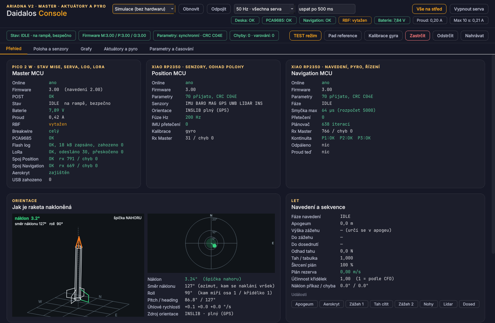

# Daidalos — diagnostická konzole

Master MCU připojený USB kabelem → stav celé rakety: tři desky, verze firmwaru, chyby,
orientace (3-D model, terč náklonu), poloha vůči rampě, grafy, editor parametrů
(včetně časování událostí) a celá Actuator Console jako záložka (v TEST režimu).

```bat
python -m pip install -r requirements.txt
python daidalos_diag.py
python daidalos_diag.py --port COM5
python daidalos_diag.py --demo
```



Podrobně: [`../../USER_MANUAL.md`](../../USER_MANUAL.md), kapitola 9.
`daidalos_widgets.py` (3-D raketa, terč náklonu, grafy, mapa rampy) používá i
`Ground_Visualizer/ground_visualizer.py`.
