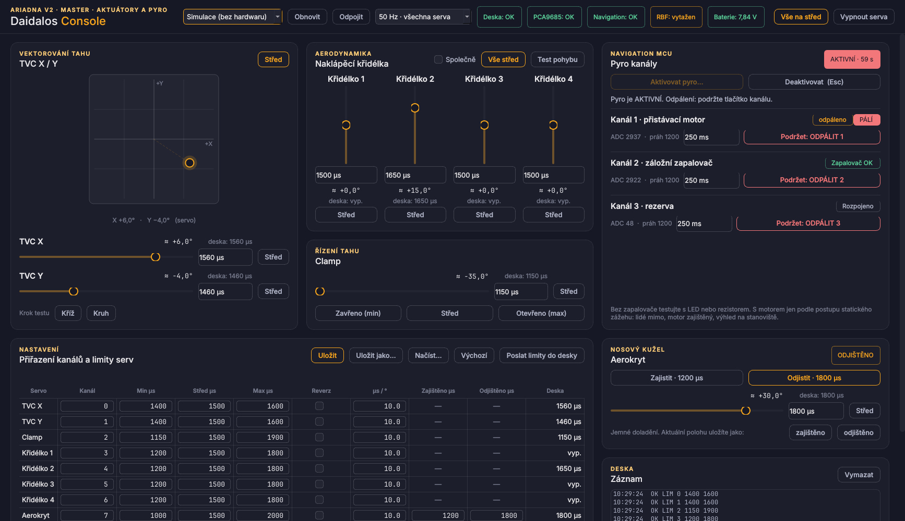

# Actuator Console — servos and pyros from one window

A bench tool: every actuator on the Master's PCA9685 (TVC X/Y, thrust clamp,
aerocover latch, four fins) and the three pyro channels on the Navigation MCU,
driven from a Python GUI over USB. Styled with the VoltinoLabs design system.



| part | runs on | file |
|---|---|---|
| servo + USB bridge | Master — Raspberry Pi Pico 2 W | `Actuator_Console.ino` |
| pyro companion | Navigation — Seeed XIAO RP2350 | `../Pyro_Companion/Pyro_Companion.ino` |
| GUI | laptop, Python 3.10+ | `gui/actuator_gui.py` |

Both sketches need **Adafruit_NeoPixel**; nothing else. Like the bench tests, they
replace the flight firmware and are flashed back over afterwards.

### Install and run with one command

**Windows** — paste into `cmd` (Win+R → `cmd` → Enter). It installs Python 3.12 with
winget if there is none, downloads the GUI into `%USERPROFILE%\DaidalosConsole`,
installs PyQt6 and pyserial, writes `start.bat` there for next time, and opens the
window:

```bat
(where py >nul 2>&1 || winget install -e --id Python.Python.3.12 --accept-source-agreements --accept-package-agreements) & set "PATH=%PATH%;%LOCALAPPDATA%\Programs\Python\Launcher" & mkdir "%USERPROFILE%\DaidalosConsole" 2>nul & cd /d "%USERPROFILE%\DaidalosConsole" && curl -fsSLO https://raw.githubusercontent.com/Tomasraketak/Daidalos_Landing_Rocket_Code/main/Ariadna_V2/Examples/Actuator_Console/gui/actuator_gui.py && curl -fsSLO https://raw.githubusercontent.com/Tomasraketak/Daidalos_Landing_Rocket_Code/main/Ariadna_V2/Examples/Actuator_Console/gui/requirements.txt && py -m pip install -q --disable-pip-version-check -r requirements.txt && (echo @py "%USERPROFILE%\DaidalosConsole\actuator_gui.py")>start.bat && py actuator_gui.py
```

Running it again updates the GUI to the latest version and keeps your
`actuator_config.json`. After that, double-click `start.bat`; *Simulace (bez hardwaru)* in the port list runs without a board. If
Python was only just installed and `py` is not found, close the window and paste the
line into a new one.

**macOS / Linux:**

```sh
U=https://raw.githubusercontent.com/Tomasraketak/Daidalos_Landing_Rocket_Code/main/Ariadna_V2/Examples/Actuator_Console/gui; mkdir -p ~/DaidalosConsole && cd ~/DaidalosConsole && curl -fsSLO $U/actuator_gui.py && curl -fsSLO $U/requirements.txt && python3 -m venv .venv && .venv/bin/pip install -q -r requirements.txt && .venv/bin/python actuator_gui.py
```

### From a clone

```
cd gui
pip install -r requirements.txt
python actuator_gui.py            # choose the Master's port in the window
python actuator_gui.py --demo     # try it without hardware (simulated board)
```

## What is on the screen

| card | controls |
|---|---|
| **TVC X / Y** | 2-D pad (drag, double-click = centre, arrow keys), a slider and direct µs entry per axis, centre, cross and circle test patterns |
| **Křidélka** | four sliders with direct entry and centre; *Společně* moves all four by the same share of their travel; a motion test (centre → +50 % → −50 % → centre) |
| **Clamp** | slider, direct entry, *closed (min) / centre / open (max)* |
| **Aerokryt** | *Zajistit* / *Odjistit* drive the two stored positions; the fine slider plus *uložit jako zajištěno / odjištěno* store the current position as either |
| **Pyro kanály** | continuity (ADC counts and threshold), fired flag, pulse length, *Aktivovat* with a confirmation, *hold-to-fire* buttons, *Deaktivovat* (also **Esc**) |
| **Nastavení** | per servo: PCA9685 channel, min / centre / max µs, reverse, µs per degree, and the two aerocover positions; saved to `gui/actuator_config.json` (**Ctrl+S**) |
| **Záznam** | everything the board says except telemetry, and a line to type raw commands |

Every servo widget also shows **what the board is actually putting out**
(`deska: 1560 µs` / `vyp.`), taken from the telemetry, not from the GUI's own idea.

## Safety

**Servos.** The board starts with every channel **off** (no pulse), so nothing moves
at power-up or when the GUI connects; a servo starts when you move it or press
*Vše na střed*. The GUI sends each servo's min/max to the board (`LIM`) and the
**board** clamps every pulse to that window, itself inside 500–2500 µs, so a GUI bug
cannot drive a linkage into its end stop. Two servos mapped to one channel are
flagged in red, and the board gets the intersection of their windows. The defaults
are conservative: TVC ±100 µs (the flight code's ±10° at 10 µs/°), clamp 1150–1900 µs
(`CLAMP_US_CLOSED` / `CLAMP_US_OPEN`), fins 1200–1800 µs, aerocover 1000–2000 µs with
1200 / 1800 µs as locked / unlocked. **Measure your linkages and set the real limits
before the first move.** If the GUI goes away, servos hold their last pulse.

PWM is 50 Hz by default (any servo). 333 / 339 Hz is for digital servos only and is
global to all sixteen channels.

**Pyros.** The pyro outputs and continuity inputs are on the Navigation MCU; the
Master forwards commands to it over UART1 with two console-only packet types
(`common/actcon_pyro.h`, framed like every Ariadna packet). The rules, enforced on the
Navigation MCU and tested on a workstation (`cd ../../../test && make actcon`):

- outputs LOW at power-up and whenever not firing;
- FIRE is refused unless ARMED; ARMED expires by itself after **60 s**;
- the Master's heartbeat lost for **0.5 s** → disarmed, a pulse in progress is cut;
- one channel at a time, pulse 20–1000 ms; **every pulse ends disarmed**;
- each command is sent three times with one sequence number, so one click is at
  most one pulse.

On top of that the Master refuses ARM / FIRE while the **RBF pin is in** or the
Navigation MCU is silent, and disarms when the GUI has been silent for 1.5 s. The GUI
asks for confirmation before arming and fires only after the button is **held for
1.2 s**. While armed the Master chirps the buzzer once a second and both boards' LEDs
flash amber.

> Bench this with LEDs or resistors on the pyro outputs first. With an igniter or a
> motor connected, follow the static-fire procedure: people clear, motor restrained,
> line of sight from the laptop. Set `CONT_ACTIVE_HIGH` / `CONT_THRESHOLD` in
> `Pyro_Companion.ino` from your own harness (the Navigation bench test prints the
> counts), exactly as for the flight firmware.

## LEDs

| Master (SK6812) | Navigation (on-board) | meaning |
|---|---|---|
| blue blink | blue blink | no GUI / no Master heartbeat |
| dim green | dim green | connected, pyros safe |
| red/blue alternating | — | PCA9685 not answering |
| amber flashing + buzzer chirp | amber flashing | pyros ARMED |
| red | red | a pyro channel is firing |

## Serial protocol (Master USB, 115200, one command per line)

| command | effect |
|---|---|
| `HELLO` | → `I ACTCON 1 16` |
| `PWM <hz>` | PCA9685 frequency, 40–400 |
| `LIM <ch> <min> <max>` | pulse window of channel 0–15, µs |
| `SET <ch> <us>` | pulse, clamped to the window (no reply, the GUI streams these) |
| `OFF <ch>` / `OFF ALL` | no pulse |
| `ARM` / `DISARM` | pyro arming on the Navigation MCU |
| `FIRE <ch> <ms>` | pyro channel 1–3 |
| `HB` | heartbeat (any line counts) |
| `STATUS` | telemetry now |

Every 100 ms the board prints `T {json}` with `pca`, `hz`, `rbf`, `vbat`, `us[16]`,
`nav`, `arm`, `arm_left`, `cont[3]`, `thr`, `cmask`, `fired`, `firing`, `rej`.
Replies are `OK …` / `ERR …`; log lines start with `#`. Any serial terminal works
too, so the GUI is optional.
