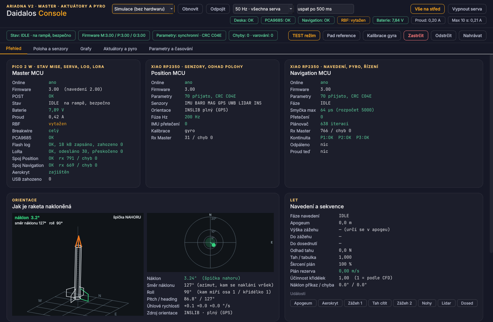

# Daidalos / Ariadna V2 — uživatelský manuál

Tento manuál je pro člověka, který **nemá kód nastudovaný** a potřebuje:

* pochopit, co která část rakety a softwaru dělá a proč,
* zkontrolovat, že to dělá správně,
* raketu připravit, ovládat a po letu vyhodnotit.

Kde je potřeba jít do hloubky, odkazuje manuál přímo na soubor a funkci. Čísla v textu jsou
výchozí hodnoty; skoro všechna se dají změnit v diagnostickém GUI (kapitola 9) bez
přeprogramování.

> 📏 **Kalibrace** — jak získat každou kalibrační hodnotu (serva, senzory, lidar, UWB,
> hmotnost, setrvačnost, Cd, aerobrzda, motor, data z letu): [`CALIBRATION_MANUAL.md`](CALIBRATION_MANUAL.md).

> ✅ **Co zbývá** (software, testy na hardwaru, kalibrace): [`TODO.md`](TODO.md).

> ⚠️ **Software je nelétaný.** Je ověřený v simulaci a na stole proti simulaci, ne v letu.
> Kapitola 12 (předletové testy) není doporučení, je to podmínka.

---

## Obsah

1. [Co Daidalos dělá — let v jednom odstavci](#1-co-daidalos-dělá)
2. [Hardware: desky, piny, kanály](#2-hardware)
3. [Časová osa letu a události](#3-časová-osa-letu)
4. [Kde raketa je: odhad polohy a orientace](#4-odhad-polohy-a-orientace)
5. [Navedení a řízení (algoritmus z LandSim_Light)](#5-navedení-a-řízení)
6. [Křidélka a jejich adaptace za letu](#6-křidélka)
7. [Sekvence událostí: aerokryt, roznět, záložní roznět, nohy](#7-sekvence-událostí)
8. [Bezpečnost: zastrčení, pojistky, co se stane když…](#8-bezpečnost)
9. [Diagnostická konzole (USB)](#9-diagnostická-konzole)
10. [Pozemní stanice a vizualizace (LoRa)](#10-pozemní-stanice-a-vizualizace)
11. [Parametry — kompletní seznam](#11-parametry)
12. [Předletové testy a postup na rampě](#12-předletové-testy)
13. [Sestavení, nahrání, testy na počítači](#13-sestavení-a-testy)
14. [Co je a co není ověřeno](#14-co-je-ověřeno)
15. [Řešení problémů](#15-řešení-problémů)

---

## 1. Co Daidalos dělá

Raketa vzlétne na hlavním motoru, ve vrcholu dráhy (apogeu) se díky křidélkům otočí špičkou
dolů a padá. Pod špičkou je **přistávací motor** (tuhé palivo, nejde vypnout ani
přiškrtit — jen **odklonit část tahu klapkou**, „clamp“). Software v apogeu podle výšky a
driftu vybere **výšku zážehu**, během pádu drží raketu křidélky svisle a brzdí jimi.
**0,6 s před zážehem** odjistí aerokryt, v pravou chvíli zapálí roznět (PYRO1), a když do
150 ms necítí nárůst zrychlení, zapálí záložní roznět (PYRO2). Během hoření řídí směr tahu
(TVC, dvě serva trysky), křidélka a klapku tak, aby raketa dosedla svisle, s nulovou
vodorovnou rychlostí a pod 4 m/s. **1,7 s před plánovaným dosednutím** přepálí gumičku
přistávacích nohou (PYRO3, alespoň 0,5 s).

Celou dobu posílá telemetrii přes LoRa na pozemní stanici, kde ji ukazuje vizualizace.

---

## 2. Hardware

Přesné zapojení každého pinu je v [`Ariadna_V2/PINOUT.md`](Ariadna_V2/PINOUT.md). Zde
přehled:

| deska | MCU | co dělá | firmware |
|---|---|---|---|
| **Master** | Raspberry Pi Pico 2 W | stav mise, **všechna serva** (PCA9685), flash log, LoRa, zastrčení, tabulka parametrů, USB diagnostika | `Ariadna_V2/Master_MCU` |
| **Position** | Seeed XIAO RP2350 | **TriSense Pro** (IMU, barometr, magnetometr), GPS, UWB tag, **TF-Luna lidar**, odhad polohy a orientace | `Ariadna_V2/Position_MCU` |
| **Navigation** | Seeed XIAO RP2350 | navedení, řízení, **všechny tři pyro kanály**, sekvence událostí | `Ariadna_V2/Navigation_MCU` |
| UWB tag | XIAO RP2350 + DWM1000 | měří vzdálenost ke kotvám | `Ariadna_V2/Uwb_Tag` |
| UWB kotva ×4 | XIAO RP2350 + DWM1000 | pozemní majáky kolem rampy | `Ariadna_V2/Uwb_Anchor` |
| Pozemní stanice | Raspberry Pi Pico 2 | příjem LoRa, OLED, USB do počítače | `Ariadna_V2/Ground_Station` |

### Kanály serv (PCA9685 na Masteru, 339 Hz, **jen digitální serva**)

| kanál | co | poznámka |
|---|---|---|
| 5 | TVC osa 1 (X) | znaménko `srv.tvc_x_sign` |
| 6 | TVC osa 2 (Y) | znaménko `srv.tvc_y_sign` |
| 7 | klapka (clamp) | `srv.clamp_closed_us` … `srv.clamp_open_us` |
| 8 | **aerokryt** | `srv.cover_lock_us` / `srv.cover_unlock_us` |
| 9–12 | křidélka 1–4 | křidélko 1 leží na tělesové ose 1 (strana serva TVC X), další po 90° |
| 0–4, 13–15 | volné | letový software je nepoužívá; v GUI karta *Volné výstupy* (TEST režim) |

Výchozí od fw 3.28 (dřív 0–7). **Kanál každého serva je parametr** (`srv.ch_*`) a mění se z
diagnostického GUI: záložka *Aktuátory* → tabulka *Přiřazení kanálů a limity serv* → **Zapsat do
rakety** (uloží trvale do flash Masteru; stejně i Min/Max, střed = trim, reverz = znaménko, µs/°,
polohy aerokrytu). Osm letových serv musí mít různé kanály, jinak Master použije výchozí
zapojení a hlásí chybu serv (nelze zastrčit). Master zapisuje jedním I²C přenosem rozsah od
nejnižšího po nejvyšší použitý kanál — serva vedle sebe = nejkratší zpoždění.

### Pyro kanály (Navigation MCU)

| kanál | pin | co | kontinuita |
|---|---|---|---|
| PYRO1 | D3 | **hlavní roznět** přistávacího motoru | D0 (A0) |
| PYRO2 | D8 | **záložní roznět** téhož motoru | D1 (A1) |
| PYRO3 | D9 | **přepálení gumičky nohou** | D2 (A2) |

### I²C sběrnice Position MCU (D4/D5, 400 kHz)

BMP580 a AK09918C (na TriSense), UWB tag (0x2A), **TF-Luna lidar (0x10)**. IMU ICM42688P
je na SPI (D8–D10, CS D3) — **sběrnice patří jen TriSense**, nic dalšího na ni nepřipojovat.

---

## 3. Časová osa letu

Stav mise vede Master (`ariadna_state_t`), fáze navedení vede Navigation MCU (`dg_phase_t`).

```
 Master:  BOOT → IDLE → ARMED → ASCENT → APOGEE → DESCENT → GUIDANCE → LANDED → RECOVERY
 Navig.:  IDLE ─────────────── ASCENT ──────── DESCENT ── IGNITING → BURN ── DONE
                                                  │           │        │
            aerokryt odjištěn  t_ign − 0,6 s ─────┘           │        │
            PYRO1 hlavní roznět  = příkaz k zážehu ───────────┘        │
            PYRO2 záložní, když do 150 ms žádný skok zrychlení         │
            PYRO3 nohy  t_dosed − 1,7 s, ≥ 0,5 s ──────────────────────┘
```

| okamžik | kdo rozhoduje | podle čeho |
|---|---|---|
| start (ASCENT) | Master | přerušený breakwire, NEBO zrychlení > `mst.launch_g` (3 g), NEBO výška > 15 m |
| apogeum (DESCENT) | Navigation MCU | klesá rychleji než 3 m/s a je 1,5 m pod maximem; maximum ≥ `seq.apogee_min_m` |
| výška zážehu | Navigation MCU, v apogeu a pak **10× za s během pádu** | pásmo z LandSim + pád s **naměřeným odporem**, kap. 5.1 |
| aerokryt | sekvencer | odpočet do zážehu ≤ `seq.cover_lead_s` (0,6 s) |
| zážeh (IGNITING) | navedení | výška ≤ výška zážehu, padá > 3 m/s, osa tahu nahoru |
| tah cítit (BURN) | navedení | osové zrychlení vzroste o ≥ `g.onset_bump` (4 m/s²) dva vzorky po sobě |
| záložní roznět | sekvencer | po `seq.backup_win_s` (150 ms) od příkazu stále žádný tah |
| nohy | sekvencer | odpočet do dosednutí ≤ `seq.legs_lead_s` (1,7 s), výška ≤ `seq.legs_h_max_m` |
| GUIDANCE (Master) | Master | Navigation hlásí fázi ≥ IGNITING (záložně výška < 60 m) — od té chvíle Position MCU nevěří barometru |
| LANDED | Master | výška < 3 m a stojí, nebo Navigation hlásí DONE |

---

## 4. Odhad polohy a orientace

Vše dělá **Position MCU**. Výsledek (`ariadna_nav_state_t`, 240× za sekundu) jde přes
Mastera do Navigation MCU.

### 4.1 Orientace — TriSenseINSLIB (výchozí)

Přepínač `ARIADNA_USE_INSLIB` na začátku `Position_MCU.ino` (výchozí 1).

* **Proč ne běžný komplementární filtr.** Ten se „vyrovnává“ podle akcelerometru za
  předpokladu, že měří gravitaci. Při volném pádu měří odpor vzduchu, při hoření tah —
  **v ne-1g prostředí** by orientaci systematicky kazil.
* **INSLIB** (15stavový error-state Kalmanův filtr, knihovna
  [TriSenseINSLIB](https://github.com/Tomasraketak/TriSenseINSLIB)) integruje gyro a chyby
  orientace opravuje přes **rychlost z GPS** — při zrychlování se chyba náklonu projeví
  jako chyba rychlosti, a tu GPS vidí. Bez GPS běží jako AHRS.
* Orientace se přebírá **jako matice**, ne jako Eulerovy úhly → žádná singularita.
  Převod rámců INSLIB (FRD/NED) na rámec rakety (TriSense/ENU rampy) je pevná permutace
  `ins_to_pad()`, kterou **při každém startu kontroluje self-test** (kap. 14).
* Na rampě INSLIB sám pozná klid (ZUPT). **Od startu je automatický ZUPT vypnutý** —
  raketa v ustálené terminální rychlosti „vypadá“ jako stojící.
* ⚠️ Licence: INSLIB je **AGPL-3.0** → firmware Position MCU s ním je také AGPL.

Alternativa (`ARIADNA_USE_INSLIB 0`): fúze z knihovny Voltino TriSense; za letu se pak
korekce z akcelerometru/magnetometru vypnou (`pos.att_gyro_only = 1`).

### 4.2 Poloha a rychlost — tři Kalmanovy filtry

`common/ariadna_kf.h`, třída `Estimator` v `Position_MCU.ino`. Pro každou osu (východ,
sever, nahoru) jeden filtr se stavy **poloha, rychlost, bias akcelerometru**. Predikce
240 Hz ze zrychlení (bez gravitace, v rámci rampy), korekce:

| zdroj | osa | poznámka |
|---|---|---|
| barometr (50 Hz) | svislá | vztaženo k tlaku na rampě; **při zážehu se mu přestane věřit** (plamen) |
| GPS (poloha + rychlost) | vodorovné | **zpoždění `pos.gps_latency_ms` (50 ms)**: fix se porovná s tím, kde raketa *byla* |
| UWB (0–4 kotvy) | vodorovné (+ svislá při 4 kotvách) | kap. 4.3 |
| **lidar TF-Luna** | svislá | kap. 4.4 |
| ZUPT | všechny | jen na rampě, jen když Master říká, že je na rampě |
| slabý prior rychlosti | vodorovné | 1× za s, když není GPS — drží vodorovnou rychlost v rozumných mezích |

**Co když vypadne GPS:** vodorovný kanál pokračuje mrtvým výpočtem, jeho nejistota
(`σ`, vidět v diagnostice) poctivě roste. Navedení řídí **rychlost** k nule, ne polohu
k bodu, takže krátký výpadek GPS let neohrozí. Platnost navigace (`VALID`) GPS
nevyžaduje — let se řídí z barometru, IMU a lidaru.

### 4.3 UWB — a co když kotvy vypadnou

`common/ariadna_uwb.h`. Řešení se **degraduje po krocích, neselže**:

| kotev | výsledek |
|---|---|
| 4 | plná 3-D poloha (výška jen pokud ji geometrie opravdu vidí) |
| 3 | 3-D nebo 2-D |
| 2 | vodorovná poloha, výška z filtru; nejistota protáhlá ve směru nejednoznačnosti |
| 1 | jen vzdálenost ke kotvě → stále brzdí vodorovný drift |
| 0 | jako bez UWB |

Každý režim dává stejný tvar: poloha + nejistota na osu. Filtr tedy nemá žádnou logiku
„kolik kotev“ — špatná geometrie má prostě velkou nejistotu a malou váhu. Kotva, která
přestane odpovídat, sama „zestárne“. Vzdálenosti se před řešením přepočítají na stejný
okamžik (raketa se pohybuje), odražené signály chytí test reziduálu.

### 4.4 Lidar TF-Luna (na vyklápěcí noze)

Pod ~7 m je barometr v plamenu motoru a ukazuje až o metr vedle. Lidar vidí zem přímo.
**Lidar je na noze**, takže dokud noha není vyklopená, míří kamkoli (do trupu, do boku).

* **Hradlo nohou.** Navigation MCU při přepálení gumičky (PYRO3) nastaví událost
  `LEGS`; Master ji okamžitě přepošle Position MCU (`master_state.nav_events`). Lidar se
  do fúze započítá až **`pos.lidar_delay_ms` (500 ms) po aktivaci nohou** — noha musí
  stihnout dopadnout do dorazu. V diagnostice svítí příznak **LIDAR povolen**.
* Čte se 50× za s po vyklopení nohou (5× za s jinak, jen aby bylo vidět, že žije).
* **Vymaxovaná hodnota se ignoruje**: měření na stropu rozsahu senzoru (≥ 7,8 m), mimo
  rozsah signálu nebo nad `pos.lidar_max_m` (7,5 m) se nezapočte — „max“ neznamená
  „jsem 8 m nad zemí“, ale „nic nevidím“.
* **Korekce náklonu.** Směr paprsku se počítá v tělesových osách ze **statické montážní
  odchylky** lidaru `pos.lidar_tilt_x_deg` / `pos.lidar_tilt_y_deg` (±20°, nastavuje se
  v diagnostice) a otočí se aktuální orientací rakety:
  `d = R · (sin ty·cos tx, −sin tx, cos ty·cos tx)`.
  Výška = vzdálenost × cos(úhel paprsku od svislice) + `pos.lidar_offset_m`. Paprsek
  odkloněný od svislice o víc než 25° se nepoužije.
* Další podmínky: Master hlásí DESCENT/GUIDANCE, `pos.lidar_enable = 1`.
* **Jak změřit montážní odchylku:** raketa svisle (špička dolů nad zemí, nebo vodováhou),
  nohu vyklopit, v záložce Poloha a senzory porovnat vzdálenost lidaru se známou výškou
  při náklonu rakety o ±10° v obou osách. Odchylka je úhel, o který je paprsek odkloněný
  od podélné osy rakety: kladná `tilt_x` = otočení kolem tělesové +X (paprsek k −Y),
  kladná `tilt_y` = kolem +Y (paprsek k +X).
* **Lidar má autoritu**: když filtr jeho měření 3× po sobě odmítne, výška se na lidar
  přenastaví skokem (simulace ukázala, že skok je lepší než pozvolné „dotažení“).
* Jakmile lidar vidí zem, navedení zahodí bezpečnostní rezervu výšky `g.alt_pad_m`
  (kap. 5.3) a v telemetrii se rozsvítí událost **Lidar**.

---

## 5. Navedení a řízení

Algoritmus je port z simulace
[LandSim_Light](https://github.com/Tomasraketak/LandSim_Light) (`tvc_sim.py`, kapitola
README „The flight algorithm, step by step“). Kód: `Ariadna_V2/common/guidance.cpp`.
**Tabulky (motor, zisky, výška zážehu) se generují ze simulace** nástrojem
`tools/gen_guidance_tables.py` → `common/guidance_tables.h`, a test
`test/guid_test.cpp` porovnává `guidance.cpp` s čísly, která spočítá sama simulace.

### 5.1 Výška zážehu (pásmo z LandSim, výpočet v letu z naměřeného odporu)

Hmotnost, Cd ani tah nejsou předem přesně známé, proto výška zážehu **není pevná
tabulka podle apogea**. Je rozdělená na dvě části:

**a) Pásmo proveditelnosti — počítá LandSim na počítači.** Pro každou rychlost pádu `|vz|`
(4, 6, 8 … 66 m/s) simulace najde pásmo výšek `h_min(|vz|) … h_max(|vz|)`, ze kterých
přistávací motor ještě dovede raketu na zem (funkce `project_rh` z `tvc_sim.py`). Pásmo
závisí na hmotnosti, motoru a odporu, **ne na apogeu**. Tabulka (2× 32 čísel) je
v parametrech (`tbl.*`), takže se po změně rakety jen přepočítá v diagnostice a nahraje —
bez přeprogramování (kap. 9, záložka *Zážeh a LandSim*).

**b) Kde raketa do pásma vletí — počítá raketa 10× za sekundu.** Na druhém jádře
Navigation MCU se z **aktuální** výšky, svislé a vodorovné rychlosti nasimuluje volný pád
(2-D, s odporem, krok 5 ms) a hledá se bod, kde výška klesne pod

```
h_cmd = min(h_min(|vz|) + pad, h_max(|vz|))       pad = |vz| · g.ign_delay_pad_s (0,4 s)
```

Zapálit **výš** se dá opravit přiškrcením, zapálit **níž** nejde opravit vůbec — proto se
rezerva počítá na nejhorší zpoždění roznětu. Typicky ~50 m pro apogeum 150 m.

**c) Odpor se měří za letu — i s aerobrzdou křidélek.** Při pádu jsou křidélka roztažená
jako aerobrzda (+,−,+,−, `fin.max_deg`), což zhruba zdvojnásobí odpor. Odpor křidélek je ve
dvou parametrech jako přírůstek k Cd trupu: `g.fin_dcd_zero` (neutrál, hoření) a
`g.fin_dcd_brake` (brzda, pád); oba počítá LandSim. Brzda dostává jen výchylku, kterou
nepotřebuje řízení — firmware proto sleduje, kolik brzdy křidélka skutečně mají (střídavý
součet čtyř výchylek, filtr 0,5 s), a model odporu i pád do pásma počítá s tímto roztažením
(Cd ∝ druhé mocnině).  Během pádu (|v| > 15 m/s, osa rakety do 18° od směru
proudění) se z osového zrychlení spočítá `K = a / v²` a porovná s modelem
(`g.cd_body`, průměr `g.diameter_m`, brzda křidélek). Poměr (`drag_scale`, „Odpor měřený
/ model“ v diagnostice) se filtruje s časovou konstantou 1 s a omezí na 0,4–2,5. Tím se
opraví jak špatně odhadnuté Cd, tak hmotnost (`a = F/m` — těžší raketa vypadá jako menší
odpor). Pád i plánovač hoření pak počítají s tímto naměřeným odporem (při hoření omezeno
0,6–1,6). `g.drag_adapt = 0` adaptaci vypne.

Výška zážehu i odpočet „ZÁŽEH za …“ se tak **přepočítávají průběžně** celý sestup; v
diagnostice a telemetrii je vidět i aktuální pásmo (`Pásmo zážehu`). V testu (`make guid`)
odpovídá výpočet rakety přímému hledání v simulaci (`find_ignition`) do 0,8 m a raketa
s odporem o 30 % menším nebo o 40 % větším, než čeká model, ho za letu změří (0,71 / 1,36)
a přistane.

> ⚠️ **Obálka.** S výchozí raketou existuje pásmo do pádové rychlosti ~55 m/s, tj.
> apogeum zhruba **80–190 m**. Nad tím přistávací motor sám přistání neuzavře; software
> pak zapálí v „nejlepším pokusu“ (nejnižší dopadová rychlost), ale dosedne tvrdě (test:
> apogeum 200 m → −8 m/s). Diagnostika (záložka *Zážeh a LandSim*) ukáže obálku pro
> zadanou hmotnost. Nastavení `g.h_ign_bias_m` posune výšku, `g.h_ign_override_m` ji
> přepíše (jen pro zkoušky).

### 5.2 Kam mířit — zákon navedení (200 Hz)

```
t_go = 2·h / |vz|                         (zbývající čas)
a = ( −vx/t_go , −vy/t_go , |vz|/t_go + g ) + kredit za odpor vzduchu
u = a / |a|                               (požadovaný směr tahu)
```

Požadavek „zastav vodorovnou i svislou rychlost do t_go“ — tím se raketa celý let snaží
držet **nulovou vodorovnou rychlost**. Náklon je omezen kuželem `1,5°/m · h + 1,5°`,
nejvýš 20° — u země skoro svisle, protože náklon stojí svislý tah.

### 5.3 Rezerva výšky

Dokud lidar nevidí zem, navedení počítá, jako by raketa byla o `g.alt_pad_m` (1 m)
**níž**, než ukazuje výškoměr. Brzdí tedy dřív. V simulaci to zvedlo úspěšnost z 90 % na
99 %; po zachycení lidarem se rezerva zahodí.

### 5.4 Natáčení trysky — smyčka náklonu (200 Hz)

1. **Chyba** jako rotační vektor `e = asin|b×u| · (b×u)/|b×u|` (b = osa rakety). Žádné
   úhly, žádné přetékání přes 360°.
2. **Roll se oddělí** — tryska kolem podélné osy točit neumí.
3. **Dvě vnořené P smyčky** (úhel → úhlová rychlost → úhlové zrychlení), šířka pásma
   `g.wn_tvc`, tlumení `g.zeta_tvc` (fitováno v simulaci), škálované podle skutečného tahu.
4. **Integrátor** `g.att_ki` — vyrovná vychýlenou osu tahu nebo těžiště mimo osu
   (v simulaci +26 bodů úspěšnosti).
5. **Dopředná kompenzace** aerodynamického momentu a gyroskopické vazby od rotace.
6. **Dynamická inverze** `s = (b × τ)/(T·L)` — moment → úhel trysky, přesně. Proto jeden
   zisk platí od 12 N do 120 N tahu.

Rychlosti se berou **přímo z gyra**, nikdy derivací orientace (to by šum nasytil serva).

### 5.5 Kolik tahu — plánovač klapky (10 Hz, druhé jádro)

Každých 100 ms simuluje zbytek letu dopředu (svisle, krok 20 ms) a hledá **nejnižší
konstantní otevření klapky**, které dovede raketu na zem rychlostí −0,5 m/s
(`g.plan_target_mps`). Úroveň platí `g.plan_hold_s` (0,3 s), pak plánovač počítá s plným
tahem. Zbytek tahu „zahodí“ (palivo hoří stejně, klapka jen odkloní proud).

* Klapka je **při zážehu naplno otevřená**, dokud motor nedosáhne 30 % špičkového tahu.
* **Odhad tahu z akcelerometru:** `T = a_osové · m − odpor`. Poměr ke katalogové
  křivce (`Tah / tabulka` v diagnostice) jde do plánovače — motor slabší o 10 % se pozná
  za 0,2 s. Plánovač navíc počítá jen s 97 % odhadu (`g.plan_margin`).
* **Předpověď tahu** (LandSim, druhý audit): odchylka tahu od tabulky se nebere jako
  vlastnost motoru, ale jako výkyv, který odezní — plánovač počítá s tím, že se odhad vrací
  k tabulce s časovou konstantou `g.plan_ts_tau_s` (0,7 s). Dřív silná první půlsekunda
  vedla k zahození tahu a pak k tvrdému dosednutí, když se výkyv otočil.
* **Koncový zákon** pod 3 m (když je motor ještě silný): sleduje profil
  `vz_ref = −√(16·h)` omezený 0,8–2,5 m/s.

### 5.6 Odpočty

Navedení počítá **čas do příkazu k zážehu** (z pádu s naměřeným odporem, 10× za s) a **čas
do dosednutí** (před zážehem jednou za sekundu odhadem; během hoření 10× za s simulací
zbytku letu stejným plánovačem, jakým se řídí — včetně přeplánování každých 0,3 s a
výškové rezervy). Z nich sekvencer časuje aerokryt a nohy; oba jdou i do telemetrie.

Přesnost v testu (celá obálka, poruchy tahu, odporu, zpoždění roznětu): aerokryt
0,6 ± 0,08 s před zážehem; nohy **1,6–2,1 s** před skutečným dosednutím (cíl 1,7 s, odchylka
téměř vždy na bezpečnou stranu — dřív). Noha s lidarem má tedy vždy ≥ 1 s na vyklopení a
500 ms hradlo lidaru.

---

## 6. Křidélka

Čtyři celopohyblivá křidélka 0,5 m za těžištěm, ±15°. Směšovač (`dg_fin_mix()`):

```
výchylka_i = roll + A·cos(φ_i) + B·sin(φ_i) + příčný_proud_i + brzda·(+,−,+,−)
```

| úloha | kdy |
|---|---|
| **řízení náklonu** — moment, který neudělá tryska (celý, když motor nehoří) | po apogeu; před apogeem dle `fin.ascent_mode` |
| **tlumení rotace** kolem podélné osy (tryska to neumí) | celý let |
| **aerodynamická brzda** — roztažení +,−,+,− (žádný moment, jen odpor ×2) | volný pád, zasunuto při zážehu |
| **zrušení vlastního příčného proudění** — aby výchylka = úhel náběhu | vždy, když se řídí |
| **omezovač pádu vztlaku** — úhel náběhu nikdy přes pád − 1,5° | vždy |

Ve volném pádu křidélka drží raketu **svisle**, volitelně mírně nakloněnou proti driftu
(`fin.drift_gain`), aby trup sám brzdil vodorovnou rychlost. 40 m nad zážehem
(`fin.ctrl_lead_m`) přebírá zákon navedení. Pod 8 m/s (`fin.min_airspeed`) křidélka nemají
účinek a neřídí se.

### 6.1 Adaptace na skutečnou sílu křidélek

Simulace bere vztlak z CFD. Skutečná křidélka budou jiná (jiný sklon vztlakové čáry,
převod táhla, servo nasazené o zub vedle). Proto navedení **za letu měří, co křidélka
opravdu dělají** (`fin_adapt_step()` v `guidance.cpp`):

```
y = κ · (zadaná výchylka) + offset
```

* `y` je výchylka, která by podle modelu vysvětlila **naměřené úhlové zrychlení z gyra**
  (po odečtení modelovaných momentů trupu, tlumení a gyroskopické vazby);
* **κ** (účinnost, 1 = jak CFD) se učí jen ze **změn** signálu, **offset** (3 hodnoty:
  dvě osy + roll) jen ze středních hodnot — konstantní porucha se tak nemůže tvářit jako
  zesílení;
* obě strany mají stejný filtr a příkaz je zpožděný o latenci serva, aby se porovnávalo
  srovnatelné;
* κ je omezeno na 0,4–2,0, offsety na ±4°; běží **jen bez tahu motoru** (tryska by
  regresi přebila), při zážehu se zmrazí a dál se používají.

Směšovač pak dělí příkaz κ a odečítá offset. V testu s křidélky o 40 % slabšími a s 1,5°
a 0,8° offsetem odhad došel na κ ≈ 0,67 a raketa přistála; bez adaptace přistála také, ale
s rotací až 257 °/s (s adaptací 76 °/s). Vypnout: `fin.adapt = 0`.

---

## 7. Sekvence událostí

Kód `common/ariadna_seq.h` (bez Arduina, testovaný v `test/seq_test.cpp`).

| událost | pravidlo | parametr |
|---|---|---|
| **Aerokryt** | odjistí se `seq.cover_lead_s` (0,6 s) **před příkazem k zážehu**; když odpočet nikdy neplatil, nejpozději s příkazem. Je to **servo** (kanál 8), Master ho po odjištění drží odjištěný až do přistání. | `seq.cover_lead_s`, `seq.cover_enable`, `srv.cover_*_us` |
| **PYRO1** hlavní roznět | v okamžiku příkazu k zážehu | `seq.ign_pulse_s` (0,6 s) |
| **PYRO2** záložní roznět | jen když **v okamžiku příkazu ani do `seq.backup_win_s` (150 ms) po něm** palubní počítač necítí skok osového zrychlení ≥ `g.onset_bump` | `seq.backup_win_s`, `seq.backup_enable` |
| **PYRO3** nohy | `seq.legs_lead_s` (1,7 s) **před plánovaným dosednutím**, proud **nejméně 0,5 s** (`seq.legs_pulse_s`, minimum vynuceno v kódu); nikdy nad `seq.legs_h_max_m`; když během hoření odpočet není platný, nohy jdou pod 10 m | `seq.legs_*` |

Každý kanál vystřelí **nejvýš jednou** za let. Když motor necítí ani po
`g.onset_timeout_s`, navedení **předpokládá** zážeh (`g.onset_assumed_s`) a letí dál
(lepší řídit naslepo než neřídit); pozdější skok zrychlení hodiny hoření přesynchronizuje.

---

## 8. Bezpečnost

### Zastrčení (ARMED)

Master zastrčí jen když: **RBF vytažený**, navigace platná, raketa stojí na rampě (výška
< 5 m, |vz| < 2 m/s), breakwire celý, **obě desky drží stejnou tabulku parametrů** (CRC)
a buď `mst.auto_arm = 1`, nebo přišla žádost „Zastrčit“ z diagnostiky.
V okamžiku zastrčení se zachytí referenční tlak a počátek polohy.

### Pyro výstup sepne jen když platí všechno

* Master je slyšet (zpráva < 0,5 s stará), hlásí ARMED, nehlásí TEST ani ABORT;
* sekvencer o to žádá (let: fáze DESCENT…BURN);
* povolení se kontroluje **přímo na výstupu** každý takt — odebrání zastrčení **přeruší
  proud** i uprostřed pulzu.

V **TEST režimu** (jen na zemi, jen s RBF venku) jdou pyro kanály odpálit ručně z
diagnostiky — pravidla jako v Actuator Console: aktivace s potvrzením, vyprší za 60 s,
odpálení držením tlačítka 1,2 s, pulz 20–1000 ms, ztráta spojení s GUI → odjištění.

### Co se stane, když…

| porucha | reakce |
|---|---|
| navigační stav přestane chodit < 60 ms | navedení jede dál na posledním stavu |
| 60–250 ms | mrtvý výpočet z posledního zrychlení |
| > 250 ms | tryska a křidélka do neutrálu, **klapka zamrzne** (zavřít ji při hoření = jistý pád) |
| vypadne GPS | vodorovně mrtvý výpočet + UWB, nejistota roste; let pokračuje |
| vypadnou UWB kotvy | degradace podle počtu kotev (kap. 4.3) |
| lidar nevidí zem | rezerva výšky zůstane, přistání na barometru (kalibrovaném přes UWB) |
| motor nezapálí | 150 ms → záložní roznět |
| akcelerometr nevidí zážeh | po 0,5 s předpokládaný zážeh, let pokračuje |
| Navigation MCU se restartuje ve vzduchu | apogeum odhadne z energie (vždy spíš výš → zážeh spíš výš = bezpečná strana) |
| USB kabel | žádný vliv: bez připojeného počítače se diagnostika neposílá vůbec |

---

## 9. Diagnostická konzole

`Ariadna_V2/Diagnostics/daidalos_diag.py`. **Master připojený USB kabelem k počítači.**

```bat
cd Daidalos_Landing_Rocket_Code\Ariadna_V2\Diagnostics
python -m pip install -r requirements.txt
python daidalos_diag.py              :: vybrat port v okně
python daidalos_diag.py --demo       :: bez hardwaru, simulovaná raketa
```

**Windows — zástupce na ploše s automatickou aktualizací** (jednou, v `cmd`):

```bat
powershell -NoProfile -ExecutionPolicy Bypass -Command "irm https://raw.githubusercontent.com/Tomasraketak/Daidalos_Landing_Rocket_Code/main/tools/windows/daidalos_setup.ps1 | iex"
```

Doinstaluje Git a Python 3.12 (winget), stáhne celé repo jako git klon do
`Plocha\Daidalos code` (stávající složka, která není klon, se jen přejmenuje na „stara kopie“)
a vedle něj `LandSim_Light`, a vytvoří zástupce **Daidalos diagnostika** s ikonou rakety.
Zástupce při každém spuštění aktualizuje obě repa na nejnovější `main` (vlastní úpravy
sledovaných souborů odloží do `git stash`), jednou denně Python, vždy všechny balíčky
(vlastní prostředí v `%LOCALAPPDATA%\Daidalos\venv`) a pak otevře diagnostiku. Bez internetu
spustí, co je na disku. Záznam: `%LOCALAPPDATA%\Daidalos\launch.log`. Skripty:
`tools/windows/`.

**Vaše soubory jsou mimo složku s kódem:** nastavení serv (`actuator_config.json`),
nahrávky CSV, exporty parametrů, `vehicle.json` a mapové dlaždice pozemní vizualizace se
ukládají do **`Dokumenty\Daidalos`** (jinam: proměnná prostředí `DAIDALOS_DATA`). Aktualizace
složky s kódem je tedy nikdy nesmaže. Starý `actuator_config.json` ze složky s kódem (nebo ze
„stara kopie“) se při prvním spuštění převezme sám.



### Baterie: nabití a výdrž do 20 %

V kartě **Master MCU** na záložce Přehled jsou dva řádky, které počítá přímo Master
(`common/ariadna_batt.h`, jednou za minutu z pětiminutového průměru):

* **Nabití baterie** — stav nabití v % a čím se k němu došlo (napětí naprázdno, teplota vzduchu,
  kapacita, kterou model počítá jako využitelnou);
* **Výdrž do limitu** — za jak dlouho při **současné zátěži** klesne nabití na limit (výchozí 20 %,
  `batt.cutoff_pct`). Zelená > 15 min, žlutá 5–15 min, červená < 5 min nebo už pod limitem.

Vstupy jsou napětí z děliče, proud z ACS712 a **teplota** z barometru Position MCU (když Position
neposílá, počítá se s 20 °C). Master vzorkuje 1×/s do okna 300 s, první odhad je po 10 s dat
(v řádku je vidět „okno N z 300 s“), pak se obnovuje každou minutu.

Jak se číslo dělá:

1. **Pokles napětí pod zátěží.** Změřené napětí není nabití — baterie pod proudem „sedne“ o `I · R`.
   Model proto přičte zpět `I · R(T)` a dostane napětí naprázdno. Odpor `R(T) = batt.r25_mohm · e^(0,03·(25−T))`
   — při 0 °C je zhruba dvojnásobný.
2. **Napětí článku → %.** Z tabulky napětí naprázdno běžného LiPo (4,20 V = 100 %, 3,73 V = 20 %, 3,27 V = 0 %).
3. **Skutečná kapacita je menší než štítek:**
   `C = batt.cap_mah · batt.health · f(teplota) · f(proud)`.
   `batt.health` je ruční korekce pro starší/levnou baterii (0,90 výchozí = baterie dá 90 % štítku);
   `f(teplota)` = 1,00 od 25 °C a výš, pak −1 % na stupeň (0,75 při 0 °C, nejméně 0,5);
   `f(proud)` = ztráta při velkém odběru (Peukert 1,05 nad 1C = 2,2 A, nejvýš −20 %) a nikdy bonus pro malý odběr.
4. **Výdrž** = (nabití − limit) · C / průměrný proud, nejvýš 999 min. Pod 0,1 A je zátěž na odhad příliš malá
   (šum ACS712 je ~0,1 A): řádek ukáže „> 999 min“ a nabití v % platí dál.

**Ladění na vaši baterii** (doporučeno, hodnoty jsou obecné): nabijte ji naplno, zapojte stálou zátěž (např. serva
v TEST režimu) a změřte, za jak dlouho klesne na limit. Poměr skutečné a ukázané výdrže vynásobte do `batt.health`.
Pokud nabití při plné baterii neukazuje ~100 %, pravděpodobně nesedí dělič napětí (`VBAT_DIVIDER`) nebo je
jiný vnitřní odpor — upravte `batt.r25_mohm` (2S 2200 mAh: 40–80 mΩ včetně kabelů).

Odhad je **při současné zátěži**: na rampě (serva stojí, ~0,2–0,5 A) vyjde výdrž dlouhá, za letu bude odběr
řádově vyšší. Číslo na rampě tedy říká „kolik ještě vydrží na stole“, ne „kolik vydrží let“.

### Proč nezdržuje let

Master posílá diagnostiku **jen když má port otevřený počítač**. Text jde do RAM bufferu a
do USB se předá jen tolik, kolik USB právě vezme — kód nikdy na počítač nečeká. Bez kabelu
(v letu) je celá diagnostika dvě porovnání za takt. Plný buffer zahodí celý řádek (čítač
„USB zahozeno“).

### Záložky

| záložka | co ukazuje |
|---|---|
| **Přehled** | tři desky (online, **verze firmwaru**, POST, spoje, čítače chyb), **3-D model rakety** v rámci rampy (orientace, výchylka křidélek, plamen), **terč náklonu** (kam se naklání vršek, kruhy 5/10/20°, zelená = 4° brána přistání), údaje navedení (výška zážehu, odpočty, tah, škrcení, účinnost křidélek), události, a **seznam chyb a varování** seřazený podle závažnosti |
| **Poloha a senzory** | poloha vůči rampě s nejistotou a stopou, rychlost, zrychlení, příznaky navigace; GPS, UWB (kotvy, režim, reziduál), baro trim, lidar, INSLIB režim |
| **Grafy** | výška, rychlosti, náklon vs. příkaz, úhlové rychlosti, TVC + klapka, křidélka, napájení, doba smyčky Navigation MCU; okno 10–300 s, pauza |
| **Surová data IMU** | po zapnutí tlačítkem (příkaz `RAW 1`, jen na zemi) posílá Position MCU ~25×/s akcelerometr [g], gyro [°/s], magnetometr surový i kalibrovaný [µT], tlak a teplotu — v osách desky TriSense, jak jsou natištěné; tabulka + grafy. Na rampě v klidu: akcelerometr ≈ (0, −1, 0) g, \|a\| ≈ 1,00, \|ω\| < 1 °/s. Řádky `R` se ukládají i do CSV při „Nahrávat“ |
| **Kalibrace** | gyro (`CAL GYRO`; offset se sám uloží jako `imu.gyr_off_*` a slouží jako záloha, když se raketa při zapnutí hýbala); akcelerometr z 6+ libovolných poloh v klidu (offset + škála); magnetometr hard + soft iron z otáčení (s ukazatelem pokrytí směrů); **Rampa = tady** (10 s průměr GPS → `pos.pad_lat_deg/_lon_deg`, počátek navigace je pak pevně na rampě); **kontrola serv** — Master pohne každým servem o 5° a zpět a podle nárůstu proudu pozná, jestli je připojené (spouští se i po vytažení RBF, `mst.servo_check_on_rbf`, zastrčení počká; práh `mst.servo_check_ma`). Vše se ukládá jako parametry do flash |
| **Aktuátory a pyro** | **celá původní Actuator Console**, beze změny funkcí: TVC pad, křidélka (i společně a test pohybu), klapka, aerokryt (zajistit/odjistit/uložit polohy), pyro (aktivace, podržení k odpálení), konfigurace serv, záznam a ruční příkazy; **volné výstupy** (kanály PCA9685 0–4 a 13–15, které letový software nepoužívá) |
| **Parametry a časování** | celá tabulka parametrů s popisem, **rozdělená do skupin** (sekvence a pyro, raketa a motor, zážeh, TVC, křidélka, serva, Master, kalibrace senzorů a rampa, poloha a senzory); hledání v názvu i popisu, přepínač „Jen změněné“, hodnota se upravuje klepnutím; úprava, odeslání, uložení do flash, výchozí hodnoty, export/import profilu (včetně montážní odchylky lidaru `pos.lidar_tilt_*`) |
| **Zážeh a LandSim** | parametry rakety (hmotnost, palivo, Cd, průměr, škála tahu, rezerva na zpoždění, brzda křidélek), výpočet pásma zážehu simulací LandSim_Light, graf pásma s křivkou pádu, náhled výšky zážehu pro apogea 80–240 m, odeslání do rakety a uložení do flash |

Horní lišta: stav mise, verze firmwaru všech tří desek (žlutě, když nesouhlasí), shoda
parametrů (CRC), počet chyb, tlačítka **TEST režim**, **Pad reference**, **Kalibrace
gyra**, **Zastrčit/Odstrčit**, **Nahrávat** (každý řádek do CSV).

### TEST režim

Ruční ovládání serv a pyro funguje **jen v TEST režimu** (tlačítko). Vstup jen na zemi;
ze stavu ARMED vyjme (odstrčí). V TEST režimu Master přestane brát povely serv od
navedení a výstupy ovládá konzole; při odchodu z TEST se vrátí letový PWM 339 Hz a
neutrální polohy. Konzole po vstupu do TEST sama pošle PWM, uspávání a meze serv.

### Úprava časování a parametrů

1. **Načíst z desky** (dělá se i samo po připojení).
2. Upravit hodnotu (žluté pozadí = neodesláno; modré = liší se od výchozí).
3. **Odeslat změny** → Master je uloží do RAM a během pár sekund rozešle oběma deskám.
4. **Uložit do flash** (jinak se po restartu vrátí původní).
5. Zkontrolovat v horní liště „Parametry: synchronní“.

Měnit jde jen v IDLE nebo TEST. Za letu Master tabulku neposílá a desky ji nepřijímají.

**Kam se parametry ukládají.** RP2350 **nemá EEPROM**. Knihovna `EEPROM` v arduino-pico ji
jen emuluje v programové flash a při zápisu zastaví obě jádra (i XIP) — proto se
nepoužívá. Parametry jsou na **externím čipu W25Q128** (ten, kam se zapisuje i letový
záznam):

| sektor | adresa | obsah |
|---|---|---|
| 0 | 0x0000 | kopie A tabulky parametrů |
| 1 | 0x1000 | kopie B tabulky parametrů |
| 2–… | 0x2000+ | letový záznam (začíná za parametry) |

Každá kopie nese značku `DAI2`, pořadové číslo, verzi rozložení a CRC. Uloží se vždy do
**starší** kopie a hned se přečte zpět a ověří — výpadek napájení při zápisu tedy nikdy
nezničí obě. Při startu se načte platná kopie s vyšším pořadovým číslem; když žádná není
(nový čip, jiné rozložení parametrů), použijí se výchozí hodnoty. Zápis i čtení dělá
druhé jádro Mastera (vlastní flash), konzole dostane `OK PARAM SAVE …` / `OK PARAM LOAD
flash …`. Smazání letového záznamu (`LOG ERASE`) parametry nesmaže.

**Letový záznam.** Master zapisuje na flash **200× za s za letu** (ASCENT…LANDED) a
**10× za s na zemi** (záznam ze země se zastaví, když na čipu zbývají poslední 2 MB, aby
let měl vždy místo; 16 MB ≈ 14 min letu). Záložka **Letový záznam** v diagnostice:
*Zjistit obsah* → *Najít lety* (Master projde flash sám a vrátí seznam letů) → zaškrtnout →
*Stáhnout vybrané lety* (jen let + 3 s okolí) nebo *Stáhnout vše*; pak filtr (jen let /
let s okolím / vše, číslo letu, časové okno), grafy (výška, rychlost, náklon, TVC a klapka,
tah, kalibrační poměry, napájení, stav) a *Exportovat CSV*. Uložené CSV jde znovu otevřít.
Totéž z příkazové řádky: nástroj `tools/daidalos_log.py` (CSV + souhrn kalibračních
čísel, viz [`CALIBRATION_MANUAL.md`](CALIBRATION_MANUAL.md) kap. 10). Příkazy konzole:
`LOG INFO`, `LOG FLIGHTS` (řádky `LOGF`), `LOG DUMP [od [počet]]` (řádky `LOGR <n> <96 bajtů hex>`), `LOG STOP`, `LOG ERASE` — jen
když raketa nezapisuje (ne ARMED…LANDED).

### Zážeh a LandSim — postup po změně rakety

1. Do pole *LandSim_Light* zadat složku s klonem simulace (pamatuje se).
2. Vyplnit **hmotnost** (vzletová, s přistávacím motorem), **hmotnost paliva**, **Cd
   trupu**, **průměr**, **škálu tahu** (1,0 = katalog; podle statického zážehu), rezervu
   na zpoždění roznětu, brzdu křidélek.
3. **Spočítat v LandSim** — spustí `tools/gen_guidance_tables.py --vehicle … --table-json …`
   (Python s numpy, pár sekund). Graf ukáže pásmo `h_min … h_max` podle rychlosti pádu,
   tabulka pod ním výšku zážehu a dopadovou rychlost pro apogea 80–240 m (červeně mimo
   obálku).
4. **Odeslat vozidlo + tabulku do rakety** (Master musí být v IDLE nebo TEST) → pak
   **Uložit do flash**.
5. Po `PARAM LIST` záložka sama načte, co v raketě opravdu je, a graf překreslí.

Cd stačí odhadnout — raketa si odpor za letu změří (kap. 5.1 c). Pásmo ale závisí na
hmotnosti a motoru, takže **po každé změně hmotnosti přepočítat**. Zisky regulátorů se
při změně hmotnosti nepřefitují (jen setrvačnost se škáluje poměrem hmotností); při
změně o víc než ~20 % je potřeba přegenerovat celé tabulky (`make tables`). Křivka tahu
motoru a geometrie křidélek jsou zatím v `guidance_tables.h` (generované z LandSim).

### Protokol (pro terminál nebo vlastní skripty, 115200, řádky)

| příkaz | význam |
|---|---|
| `HELLO` | `I ACTCON 1 16` a `I DAIDALOS <fw> FLIGHT guidance <ver> params <n>` |
| `TEST 1` / `TEST 0` | TEST režim |
| `PARAM LIST` | řádky `PRM <id> <klíč> <hodnota> <výchozí> <min> <max> <jednotka> <deska>`, pak `OK PARAM LIST <n> <crc>` |
| `PARAM SET <id\|klíč> <hodnota>` / `SAVE` / `LOAD` / `DEFAULTS` | úprava tabulky |
| `PADREF`, `CAL GYRO`, `FLIGHTARM 1\|0`, `HB` | viz výše |
| `PWM`, `LIM`, `SET`, `OFF`, `IDLE`, `ARM`, `DISARM`, `FIRE` | Actuator Console, jen v TEST |

Master posílá každých 100 ms pět řádků JSON: `T` (aktuátory, stejný formát jako Actuator
Console), `M` (Master), `N` (navigační stav), `P` (Position MCU), `G` (Navigation MCU).
Popis polí je v `Master_MCU.ino`, sekce 13, funkce `diag_emit()`.

---

## 10. Pozemní stanice a vizualizace

### Rádio

LoRa 433 MHz, SF7, 250 kHz, 10 Hz, paket 50 bajtů (48,8 ms na vzduchu). Parametry jsou na
jednom místě v `common/ariadna_link.h` a obě strany je čtou odtud.

> ⚠️ 10 Hz je 49 % vysílacího času — nad limit 10 % pro pásmo 433 MHz v EU. Před letem
> zkontrolujte pravidla soutěže; `ARIADNA_TLM_HZ` na 2 Hz = 10 %.

Paket (`ariadna_tlm_t`, verze 4) nese: polohu (lat/lon), výšku, rychlosti, zrychlení,
**orientaci jako kvaternion**, TVC, klapku, tah, **odpočet** (do zážehu, po příkazu do
dosednutí), **události sekvenceru**, čas letu, posun od rampy v metrech, stav, fázi,
baterii, proud, GPS, pyro kontinuitu/odpálení, zdraví desek, UWB.

### Pozemní stanice (Pico 2 + OLED)

Ukazuje výšku, stav, rychlosti, baterii, během pádu odpočet do zážehu, během hoření TVC a
klapku, a řádek A/R/P/N/V/F/S (zastrčeno / RBF / spoj Position / spoj Navigation / platná
navigace / flash / serva). Tlačítka zapínají testovací data (bez rakety).

### Vizualizace (`Ground_Visualizer/ground_visualizer.py`)

```bat
python -m pip install pyserial PyQt6 PyQt6-WebEngine pyqtgraph haversine
python Ground_Visualizer\ground_visualizer.py
```

* **Orientace třikrát**: navball (jako v KSP — špička rakety), **3-D model rakety** v rámci
  rampy (oranžová = přistávací motor/špička, zelené = křidélko 1, plamen s výchylkou trysky)
  a **terč náklonu**.
* Karty: výška, stav mise (česky), rychlosti, zrychlení, **fáze navedení**, tah, klapka,
  **baterie**, proud, **náklon**, GPS, **další událost s odpočtem** („ZÁŽEH za 2,1 s“ /
  „DOSEDNUTÍ za 1,3 s“), **čas letu**, **posun od rampy**, **T-0 odpočet startu**
  (nastavíte sekundy a stisknete START T-0 — raketa čas startu nezná, ten zná operátor),
  signál, kvalita spoje, **chyba** (česky), UWB.
* Lišty: zdraví subsystémů, pyro (kontinuita/odpáleno), **události letu** (apogeum,
  aerokryt, zážeh 1, tah, zážeh 2, nohy, lidar, dosed).
* **Rozložení:** vlevo sloupec grafů (výška, zrychlení, svislá rychlost, TVC) přes celou
  výšku okna, uprostřed karty v mřížce 4 × N s lištami a pod nimi orientace, mapa a TVC;
  vpravo výškoměr. Záznam CSV (klávesa R).
* **Grafy** mají popsané osy: vlevo jednotka, dole čas v sekundách před posledním paketem.
* **Mapa** (fw 3.28): letecký snímek **ČÚZK ortofoto, 15 cm/px** (zoom 20; mimo ČR Google).
  Při startu se stáhne do `Dokumenty/Daidalos/map_cache/aerial` kolem rampy (~60 MB) a pak
  funguje bez internetu; s internetem se navíc dočítá živě. Tlačítko **MAP ⭳ PAD** stáhne mapu
  kolem aktuální rampy znovu. **Rampa** se bere z rakety: GPS poloha minus posun od rampy
  (`px/py`), průměrovaná na zemi (IDLE/ARMED), a ukládá se do `Dokumenty/Daidalos/pad.json`
  — příště se mapa stáhne rovnou tam. V rohu mapy: souřadnice rampy (zdroj), rakety a
  vzdálenost; dole měřítko.

---

## 11. Parametry

Úplný seznam s rozsahy je v `Ariadna_V2/common/ariadna_params.h` a v záložce Parametry
(sloupec „co dělá“). Skupiny:

| skupina | čte ji | obsah |
|---|---|---|
| `seq.*` | Navigation | **časování událostí**: předstih aerokrytu, okno záložního roznětu, předstih a délka nohou, délka pulzu roznětu, povolení, výškové meze |
| `g.*` | Navigation | hmotnost, palivo, **Cd trupu, průměr, škála tahu, rezerva na zpoždění roznětu, adaptace odporu, odpor křidélek (neutrál / aerobrzda), předpověď tahu**, zisky smyček (fitované v simulaci), kužel náklonu, rezerva výšky, posun/přepis výšky zážehu, plánovač, detekce zážehu |
| `tbl.*` | Navigation | pásmo zážehu z LandSim (`tbl.vz0`, `tbl.dvz`, `tbl.hmin_00…31`, `tbl.hmax_00…31`); v záložce Parametry skryté, upravuje se v záložce *Zážeh a LandSim* |
| `fin.*` | Navigation | křidélka: povolení, mez, brzda, režim při stoupání, drift, adaptace |
| `srv.*` | Master | kalibrace serv: střed, µs/°, **znaménka**, klapka, aerokryt; od fw 3.28 i **kanál každého serva** (`srv.ch_*`) a **tvrdé min/max pulzu** (`srv.*_min_us/_max_us`) — nejsnáz z tabulky serv v záložce *Aktuátory* tlačítky **Načíst z rakety** / **Zapsat do rakety** (PARAM SET + SAVE, trvale ve flash) |
| `mst.*` | Master | práh detekce startu, automatické zastrčení |
| `batt.*` | Master | model baterie pro odhad nabití a výdrže (kap. 9, „Baterie“): štítková kapacita, zdraví, vnitřní odpor, limit |
| `pos.*` | Position | **zpoždění GPS**, lidar (povolení, offset, dosah, **zpoždění po vyklopení nohou**, **montážní odchylka X/Y**), orientace jen z gyra, UWB |

Tabulka se ukládá na flash čip W25Q128 (kap. 9); rozložení verze 3 (164 hodnot; verze 3
vynutila nové zisky přefitované v LandSim po druhém auditu). Po
nahrání firmwaru s jiným rozložením se načtou výchozí hodnoty — uložené profily
(export z konzole) jde znovu importovat.

Výchozí hodnoty v `ariadna_params.h` jsou **stejné jako v navedení** — test `make seq` to
kontroluje, takže nemůže dojít k tomu, že by raketa letěla s jinými zisky, než jaké byly
ověřené.

---

## 12. Předletové testy

Pořadí. Žádný krok nevynechávat.

1. **Každá deska zvlášť** — USB konzole, POST PASS. Navigation MCU s LED místo roznětů.
2. **Spoje** — diagnostika: všechny tři desky online, stejná verze firmwaru,
   „Parametry: synchronní“, žádné rx chyby.
3. **⚠️ Znaménka TVC** — tryska se v letovém firmwaru hýbe jen během hoření, proto se
   znaménka ověřují **staticky** z definic rámců. Tělesové osy jsou osy senzoru TriSense
   (Position MCU), od fw 3.24 podle skutečné montáže: **−Y ke špičce** (na rampě nahoru,
   při přistání dolů), +X = osa 1 (`BODY_SERVO1_AXIS`), osa tahu b = **+Y**.
   Kladný příkaz osy 1 (`tvc_x_deg > 0`) vychýlí **vektor tahu k tělesové +X**, tedy
   **výstup trysky (výtokový proud) míří k tělesové −X**. Kladný příkaz osy 2 vychýlí tah
   k **b × u1 = −Z**, výstup trysky míří k **+Z**.
   Postup: TEST režim, záložka Aktuátory, serva na střed; posunout TVC X o +50 µs ×
   `srv.tvc_x_sign` od `srv.tvc_x_trim_us` (se znaménkem +1 tedy vyšší pulz). Výtok trysky
   se musí vychýlit k −X. Jinak `srv.tvc_x_sign = −1`. Totéž osa Y (výtok k +Z).
   **Tento test chytá nejnebezpečnější chybu v celém projektu** (kladná zpětná vazba → pád
   do 1 s). Obě osy, nikdy jen jednu.
4. **⚠️ Znaménka křidélek** — křidélko i sedí na r_i (1: +X, 2: −Y, 3: −X, 4: +Y, vše
   tělesově). Kladná výchylka musí dát sílu ve směru n_i = b × r_i, tj. při proudění od
   špičky k ocasu se **náběžná hrana (strana ke špičce) natočí** k:

   | křidélko | kanál | r_i | náběžná hrana při kladné výchylce k |
   |---|---|---|---|
   | 1 | 3 | +X | −Y |
   | 2 | 4 | −Y | −X |
   | 3 | 5 | −X | +Y |
   | 4 | 6 | +Y | +X |

   V TEST režimu: pulz `srv.finN_trim_us` + 50 µs × `srv.finN_sign` → zkontrolovat
   směr; opačně = `srv.finN_sign = −1`. Kontrola navíc: všechna čtyři stejně kladně →
   moment kolem osy b (kladný roll); roll damper pak musí rotaci tlumit, ne budit.
5. **Orientace** — 3-D model v diagnostice: špička nahoru ↔ „špička NAHORU“; naklonit k
   severu → terč ukazuje sever. Otočit raketu kolem osy → roll se mění, náklon ne.
6. **Kontinuita** — změřte ADC s dobrým roznětem a bez (záložka Aktuátory) a nastavte
   `CONT_THRESHOLD` v `Navigation_MCU.ino`.
7. **Aerokryt** — TEST: Zajistit/Odjistit, uložit polohy (`srv.cover_lock_us`,
   `srv.cover_unlock_us`).
8. **UWB** — raketa na změřeném bodě, poloha souhlasí, reziduál < 20 cm; vytáhnout jednu,
   pak druhou kotvu — navigace musí zůstat platná.
9. **Lidar** — noha vyklopená, držet nad zemí špičkou dolů: v záložce Senzory vzdálenost
   odpovídá. Změřit a nastavit montážní odchylku `pos.lidar_tilt_x/y_deg` (kap. 4.4).
   Ověřit, že se lidar do fúze **nezapočte**, dokud nohy nejsou aktivované (příznak
   „LIDAR povolen“ zhasnutý).
10. **Parametry rakety** — zvážit raketu, v záložce *Zážeh a LandSim* přepočítat pásmo,
    odeslat, uložit do flash; po restartu zkontrolovat, že se načetlo z flash.
11. **Statický zážeh** s klapkou a zamčeným TVC — kalibrovat `srv.clamp_*_us` podle
    změřeného tahu; poměr k katalogu zadat jako `g.thrust_scale` a přepočítat pásmo.
12. **Dosah rádia** na skutečnou vzdálenost se skutečnými anténami.

### Na rampě

1. Raketa na rampě, RBF zasunutý, zapnout. Počkat na POST (Master pomalu zeleně).
2. Diagnostika (pokud je kabel): 0 chyb, parametry synchronní, GPS fix, UWB pevně zeleně
   (LED Position MCU **svítí zeleně** = UWB přijímáno filtrem).
3. Odpojit USB kabel.
4. Vytáhnout RBF → zastrčení (Master rychle červeně + pípání).
5. Na pozemní stanici: Stav ARMED, P1/P2/P3 kontinuita, baterie > 7,4 V.

---

## 13. Sestavení a testy

Arduino IDE 2, deska **arduino-pico** (earlephilhower).

| sketch | deska | knihovny |
|---|---|---|
| `Master_MCU` | Raspberry Pi Pico 2 W | LoRa (sandeepmistry), Adafruit_NeoPixel |
| `Position_MCU` | Seeed XIAO RP2350 | [Voltino_TriSense](https://github.com/Tomasraketak/Voltino_TriSense_Library) ≥ 1.6, [TriSenseINSLIB](https://github.com/Tomasraketak/TriSenseINSLIB) (+ TinyGPSPlus), [TFLuna_I2C](https://github.com/Tomasraketak/TF-Luna-I2C-Library) ≥ 1.1.0, Adafruit_NeoPixel |
| `Navigation_MCU` | Seeed XIAO RP2350 | Adafruit_NeoPixel |
| `Ground_Station` | Raspberry Pi Pico 2 | LoRa, Adafruit_GFX, Adafruit_SSD1306 |

Lidar TF-Luna jede přes knihovnu
[TF-Luna-I2C-Library](https://github.com/Tomasraketak/TF-Luna-I2C-Library) **≥ 1.1.0**
(ta bere sběrnici jako `TwoWire&`, takže běží na senzorové sběrnici `Wire1` bez
přenastavení pinů; 1.0.0 měla špatný registr frame rate a nepřeloží se). Firmware při
startu nastaví 250 Hz a měření fúzuje jen při novém snímku (podle časové značky senzoru).

Každá složka sketche nese kopie hlaviček z `common/` (Arduino jinak nevidí mimo složku).
Upravujte **originály v `common/`** a pak `cd test && make sync-fix`.

### Testy na počítači

```
cd test
make check        # všechno níže
make guid         # navedení vs. simulace + let v uzavřené smyčce (6-DOF)
make seq          # sekvencer událostí a tabulka parametrů
make est / uwb    # Kalmanův filtr, UWB
make link / pyfmt # protokol, Python dekodér
make batt         # nabití a výdrž baterie: tabulka, pokles napětí, teplota, okno 5 min
make syntax       # překlad sketchů proti náhradním hlavičkám
make tables SIM=../../LandSim_Light   # přegenerovat tabulky ze simulace
```

`make syntax` přeloží i Position MCU proti skutečným knihovnám, když jsou vedle repozitáře
(`TRISENSE=… INSLIB=…`). Před nahráním **vždy přeložte i v Arduino IDE / arduino-cli** —
náhradní hlavičky neověří vše.

---

## 14. Co je ověřeno

| | jak | výsledek |
|---|---|---|
| navedení = simulace | `make guid`, čísla přímo z `tvc_sim.py` | směr navedení do 1e-7, plánovač shodně, motor, koncový zákon, výška zážehu do 0,8 m od `find_ignition` |
| odpor za letu | `make guid`: model s odporem ×0,7 a ×1,4 | odhad 0,71 / 1,36, obě přistanou |
| odpočty | `make guid`, každý let obálky | aerokryt 0,6 ± 0,08 s; nohy 1,62–2,11 s před dosednutím |
| hradlo lidaru | kód Position MCU (`legs_ms`, `LIDAR_CEILING_M`) | ⚠️ jen kontrola kódu, ne test na počítači |
| uložení parametrů | kód Mastera (A/B sektory, zpětné čtení) | ⚠️ ověřit na desce: SAVE → restart → LOAD |
| navedení v letu | 6-DOF model v `guid_test.cpp`: 140–180 m, drift, zpoždění roznětu 0–300 ms, tah ±8 %, rotace ±90 °/s, vítr, chybná osa tahu, ±1 m chyba výškoměru, slabá/silná/nesouosá křidélka, bez křidélek, mrtvý akcelerometr | všechny přistanou pod 4 m/s, vh < 0,5 m/s, náklon < 3° |
| sekvencer | `make seq`: časy aerokrytu/roznětů/nohou, záloha, ztráta povolení, minimum 0,5 s | 724 kontrol (spolu s parametry) |
| parametry | výchozí = navedení, rozsahy, CRC | v `make seq` |
| převod rámců INSLIB | self-test Position MCU při každém startu | — |
| protokol, Kalman, UWB | `make link/est/uwb` | beze změny |
| **co NEní ověřeno** | skutečný hardware, znaménka serv a křidélek, montáž TriSense, INSLIB na reálných datech, adaptace křidélek na reálné aerodynamice, DMA, obálka nad 190 m | **kap. 12** |

---

## 15. Řešení problémů

| příznak | příčina / řešení |
|---|---|
| „Parametry: NESOUHLASÍ“ | desky ještě nedostaly celou tabulku (pár s) nebo mají jiný firmware; restart; stejná verze všude |
| Firmware žlutě | různé verze na deskách — nahrát stejnou |
| „needs TEST mode“ | ruční ovládání jen v TEST režimu |
| nejde zastrčit | RBF, navigace nevalidní, raketa se hýbe, parametry nesouhlasí, `mst.auto_arm = 0` bez tlačítka |
| Navigation LED červeně 3× | zastrčeno, ale tabulka parametrů nedorazila |
| Navigation LED červeně 2× | zastrčeno, PYRO1 bez kontinuity |
| Position LED žlutě 3× | baro trim na mezi → špatně zaměřené UWB kotvy |
| „Baro trim na mezi“ | přeměřit polohy kotev (`s_uwb_anchors[]`) |
| lidar „neodpovídá“ | adresa 0x10, kabel, napájení; `pos.lidar_enable` |
| lidar měří, ale výška se nepřebírá | nohy ještě nejsou aktivované / neuplynulo `pos.lidar_delay_ms`; hodnota na stropu (nic nevidí); paprsek > 25° od svislice — zkontrolovat `pos.lidar_tilt_*` |
| po restartu výchozí parametry | flash bez platné kopie (nový čip, změna rozložení) — nahrát profil a Uložit do flash |
| záložka Zážeh: „V … není tvc_sim.py“ | cesta ke klonu LandSim_Light; Python s numpy |
| „Odpor měřený / model“ daleko od 1 | Cd nebo hmotnost v parametrech neodpovídá — opravit a přepočítat pásmo |
| vizualizace hlásí „DROPPED“ | jiná verze paketu (stará pozemní stanice) — nahrát stejný firmware |
| po letu: kde je záznam | flash na Masteru (50 Hz), případně CSV z vizualizace / diagnostiky |
